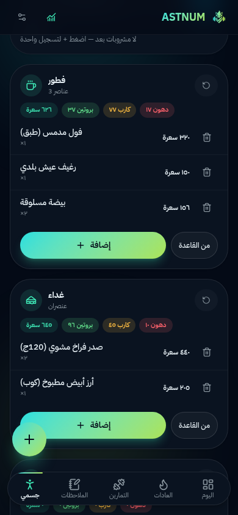
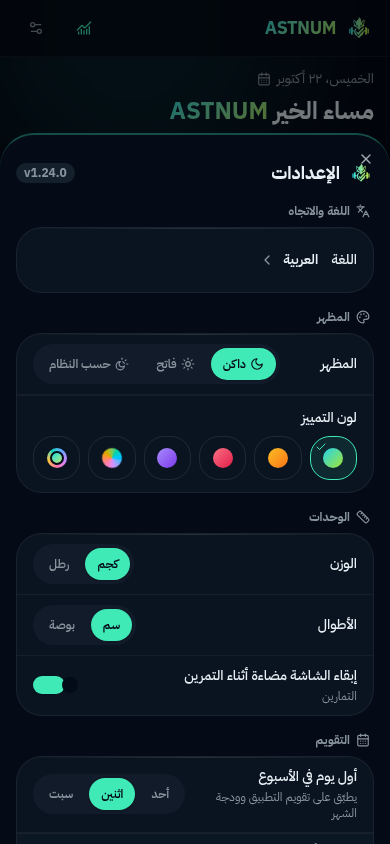

# ASTNUM — أستنِم

<p align="center">
  
</p>

**[Read in English](./README.md)** | النسخة العربية

<p align="center">
  <a href="https://github.com/btwstar/astnum/releases"></a>
  <a href="LICENSE"></a>
  
  
  
</p>


> **عادات + ملاحظات ومهام + تمارين + خريطة عضلات + قياسات + أكل وماء** — تطبيق واحد، بياناتك على جهازك، **بـ 160 لغة** (الإنجليزية أساسًا والعربية كاملة مع دعم RTL)، و**19 ودجة** لشاشة أندرويد الرئيسية — منها ودجة **«إضافة سريعة» حقيقية**: اكتب عادة أو ملاحظة — أو سجّل ماءً/عصيرًا/مشروبًا بلمسة — في نافذة عائمة فوق الشاشة الرئيسية فتُحفظ فورًا في قاعدة بيانات التطبيق **دون فتحه أصلًا**، وودجة **«عنصر مثبّت»** تعرض أي عادة أو جلسة تمرين أو ملاحظة تختارها بشكل دائم، وودجتا **ماء اليوم (1×1)** و**المشروبات (2×1)** مع هدف ماء تلقائي يُحسب من وزنك ونشاطك.

ASTNUM هو متتبّع شخصي شامل يجمع في تطبيق واحد: بناء العادات مع السلاسل (streak)، الملاحظات والمهام، تسجيل تمارين الجيم مع كشف الأرقام القياسية الشخصية (PR)، خريطة حرارية للعضلات، قياسات الجسم والصور، تتبّع الطعام والسعرات مع قارئ باركود، و**محلل بيانات محلي** يجيب عن أسئلتك من بياناتك («كم كيلو رفعت لحد الآن؟») فوريًا وبلا إنترنت.

الهوية البصرية: كحلي عميق + تدرّج نيون (سماوي → نعناعي → لايم)، شعار ثعلب + قلب بعلامة ✓ + دمبلين. النظام التصميمي كامل في [`DESIGN.md`](./DESIGN.md).

---

## 📸 لقطات الشاشة

<p align="center">
  
  
  
</p>
<p align="center">
  
  
  
</p>

---

## جدول المحتويات

1. [المزايا وخريطة الشاشات](#المزايا-وخريطة-الشاشات)
2. [حالة الشاشات (صادقة)](#حالة-الشاشات)
3. [حزمة التقنيات](#حزمة-التقنيات)
4. [التشغيل محليًا](#التشغيل-محليًا)
5. [الاختبارات والجودة](#الاختبارات-والجودة)
6. [خريطة المشروع](#خريطة-المشروع)
7. [كيف تعمل الترجمة وـ RTL](#كيف-تعمل-الترجمة-وrtl)
8. [قاعدة البيانات](#قاعدة-البيانات)
9. [المحلل (Analyst)](#المحلل-analyst)
10. [التصميم](#التصميم)
11. [حدود النسخة الحالية (بصدق)](#حدود-النسخة-الحالية)
12. [التغليف كتطبيق أندرويد](#التغليف-كتطبيق-أندرويد)
13. [الترخيص والإسناد](#الترخيص-والإسناد)

---

## المزايا وخريطة الشاشات

التطبيق مسار واحد (`/`) يعمل كـ SPA: شريط سفلي بأربع تبويبات + شاشتان Overlay (الجيم والمحلل) + ورقة إعدادات.

| الشاشة | الوصول | ما تقدّمه |
|---|---|---|
| **اليوم** (Today) | تبويب 1 | لوحة اليوم — عادات اليوم وخطة التمرين والطاقة/المهام وحرارة العضلات، حية وبلغة الجهاز |
| **العادات** (Habits) | تبويب 2 | إكمال بلمسة واحدة، سلاسل واعية بالجدول (يومي/أيام محددة/مرات في الأسبوع)، تجميد (freeze) بحصة أسبوعية، خريطة تقويم مصغّرة، إنجازات 7/30/100، سحب لإعادة الترتيب، أرشفة، إحصاءات |
| **الملاحظات** (Notes) | تبويب 3 | ملاحظات بـ Markdown + مهام بمواعيد وأولويات وتكرار (يومي/أسبوعي/أيام)، قوائم تحقق داخل الملاحظة، بحث، وسوم، تثبيت/أرشفة/سحب جانبي، مهملات 30 يومًا، التقاط سريع |
| **جسمي → عضلات** (Muscle Map) | تبويب 4 | خريطة حرارية SVG أمامية/خلفية لـ 15 عضلة، تحميل 7/30 يومًا (مجموعات أو حجم)، تلوين 5 مستويات + دعم عمى الألوان (رقم المجموعات دائمًا)، جملة رؤية (العضلات المهمَلة)، تعديل الهدف الأسبوعي لكل عضلة |
| **جسمي → قياسات** (Measurements) | تبويب 4 | وزن/دهون/عضل/ماء/دهون حشوية + محيطات (صدر/وسط/ذراع/فخذ/ورك)، اتجاهات برسوم بيانية، مقارنة قبل/بعد، تصدير CSV، صور تقدّم بضغط Canvas وقفل PIN |
| **جسمي → أكل** (Nutrition) | تبويب 4 | حلقات سعرات وماكروز، 4 وجبات، إضافة سريعة + بحث في قاعدة 171 طعامًا مصريًا/عالميًا، حساب أهداف Mifflin-St Jeor (مع سقف أمان)، باركود يدوي/كاميرا، تكرار وجبة الأمس، رسم أسبوعي، **تتبّع الماء مع هدف تلقائي من وزنك ونشاطك** (35 مل/كغ + بدل النشاط) وشرائح لمسة لإضافة ماء/عصير/مشروبات |
| **تمارين** (Gym — Overlay) | قائمة FAB السريعة ومن شاشة اليوم | مسجّل جلسة بـ 3 لمسات (اختر تمرين → وزن/تكرار → احفظ)، اقتراح تلقائي لآخر أداء، مؤقّت راحة مع بقاء-الشاشة-مستيقظة، كشف PR مع احتفال وهزّة مميزة، مكتبة 164 تمرينًا (بحث + فلاتر)، 6 قوالب تدريب، تاريخ مع رسم حجم أسبوعي وتقدّم e1RM لكل تمرين |
| **المحلل** (Analyst — Overlay) | أيقونة 📊 أو FAB | 12 سؤالًا عن بياناتك (الحجم المرفوع، أقوى رفعة e1RM، أكثر عضو، السلاسل، التزام ٣٠ يوم، تغير الوزن، سعرات/بروتين ٧ أيام) — حساب محلي فوري، بلا إنترنت وبلا حصص |
| **الإعدادات** (Settings) | أيقونة ⚙ | اللغة، المظهر (داكن/فاتح/نظام) ولون التمييز، الوحدات، **محرّر التقويم** (بداية الأسبوع + علامات الأيام بمعاينة حية)، أهداف العضلات، إعداد ودجات الشاشة الرئيسية، البيانات (نسخ احتياطي/تصدير/استعادة)، تنزيل الـAPK |

زر FAB عائم سياقي: في Today يفتح قائمة إجراءات سريعة، وفي بقية التبويبات ينفّذ إجراء التبويب مباشرة.

## حالة الشاشات

> **بصراحة تامة** — آخر تحقق بتاريخ 2026-10-22 (نسخة v1.24):

| الوحدة | الحالة |
|---|---|
| شاشة **اليوم** | ✅ كاملة — عادات اليوم وخطة التمرين والطاقة/المهام وحرارة العضلات |
| العادات (UI + API + منطق) | ✅ كاملة ومختبرة |
| الملاحظات والمهام | ✅ كاملة |
| الجيم (مسجّل، مكتبة، قوالب، تاريخ) | ✅ كاملة |
| خريطة العضلات | ✅ كاملة |
| القياسات + الصور | ✅ كاملة |
| الأكل + الباركود + **تتبّع الماء** | ✅ كاملة |
| المحلل (Analyst) | ✅ كامل — محلي خالص (أوفلاين دومًا) |
| الإعدادات (مع **محرّر التقويم**) | ✅ كاملة |
| ودجات الشاشة الرئيسية الـ19 | ✅ كاملة — تُبنى وتُحدّث محليًا على الجهاز |

الاختبارات: **103 اختبارات ناجحة / 0 فشل** في 7 ملفات (`bun test` يطابق هذا الرقم بالضبط وقت كتابة هذا التوثيق).

---

## حزمة التقنيات

| الطبقة | التقنية |
|---|---|
| الإطار | **Next.js 16** (App Router) + **TypeScript 5** (strict) |
| الواجهة | **React 19**, **Tailwind CSS 4**, **shadcn/ui** (مجموعة كاملة في `src/components/ui`) |
| الحركة | framer-motion، dnd-kit |
| الرسوم | Recharts |
| الحالة | **Zustand** (persist) لحالة التطبيق + **TanStack Query** لحالة الخادم |
| الخادم | Next.js Route Handlers (`src/app/api/**`) |
| قاعدة البيانات | **Prisma ORM + SQLite** (عميل SQLite فقط، ملف `db/custom.db`) |
| الترجمة | نظام i18n خفيف مخصص (`src/lib/i18n`) — **160 لغة** مسجّلة في `languages.ts` مع قواميس مولّدة تُحمّل عند الطلب وسلسلة احتياط (القاموس → اللغة الأساس للفرع الإقليمي → الإنجليزية) + RTL تلقائي وأرقام/تواريخ عبر `Intl` |
| الأيقونات | lucide-react فقط |

## التشغيل محليًا

المتطلبات: [Bun](https://bun.sh) ≥ 1.2 (أو Node 20+ مع npm كبديل)، لا شيء غير ذلك — قاعدة البيانات ملف SQLite محلي.

```bash
# 1) تثبيت الحزم
bun install

# 2) تهيئة متغير البيئة (مسار قاعدة البيانات المحلية) — مرة واحدة قبل أول تشغيل
cp .env.example .env

# 3) تهيئة قاعدة البيانات (يدفع مخطط prisma إلى db/custom.db)
bun run db:push

# 4) التشغيل — منفذ 3000
bun run dev
# افتح http://localhost:3000 — البيانات المرجعية (164 تمرينًا/171 طعامًا/15 عضلة/6 قوالب)
# تُزرع تلقائيًا عند أول استخدام (ensureSeed آمن للتكرار والتزامن)

# بناء إنتاجي (اختياري)
# bun run build && bun run start
```

ملف `.env` يضبط مسار قاعدة البيانات (المثال الجاهز في `.env.example`):

```env
DATABASE_URL="file:../db/custom.db"   # مسار نسبي إلى prisma/ ← يصبح <المستودع>/db/custom.db
```

> ملاحظة صادقة: أمر `db:push` يعمل بـ `--accept-data-loss` (كما هو مضبوط في `package.json`) — مناسب لمرحلة ما قبل الإطلاق. لا تستخدمه على نسخة تحوي بيانات حقيقية قبل نسخ `db/custom.db` احتياطيًا.

## الاختبارات والجودة

```bash
bun test          # 103 اختبارات: seed · streak · calories · pr · heatmap · gym-smart-session · nutrition-convention
bun run lint      # ESLint — يمر بنقاط صفر
```

- الاختبارات **وحدات نقية** فقط على المحرّكات المنطقية في `src/lib/logic/` — قابلة للاختبار والاستنساخ في النسخة الأصلية (Capacitor) كما هي.
- جودة الودجات الأصلية تُفحص كذلك عبر `scripts/javac-gate.sh` (تجميع الـ19 ودجة بـ aapt2 + javac بدون gradle).

## خريطة المشروع

```
├─ android-app/               مشروع أندرويد كامل: الـ19 ودجة الأصلية + نافذة الإضافة السريعة + الجسير
│  └─ android/app/src/main/java/app/astnum/mobile/widget/
├─ prisma/schema.prisma     مخطط SQLite — 22 جدولًا، مرآة 1:1 لمخطط النسخة الأصلية
├─ public/quickadd/          حزمة الالتقاط الخفية (مولّدة — أعد بناءها بـ scripts/build-quickadd-bundle.sh)
├─ src/app/                  مسار واحد / + واجهات REST لكل وحدة (habits, notes, tasks, gym, muscles, body, nutrition, analyst, backup, settings, demo)
├─ src/lib/api.ts            طبقة fetch الموحّدة — النقطة الوحيدة لاستبدال النقل
├─ src/lib/db.ts             عميل Prisma
├─ src/lib/logic/            دوال نقية: streak, pr, heatmap, calories, water, gym-smart, analyst
├─ src/lib/seed/             البذر: 15 عضلة، 164 تمرينًا، 334 ربط عضلة، 6 قوالب، 171 طعامًا
├─ src/lib/i18n/             سجل languages.ts (160 لغة) · locales/en + locales/ar كاملة · generated/ قواميس مولّدة تُحمّل عند الطلب
├─ src/lib/widgets/          بانِي لقطة الودجات · معالج الالتقاط · الجسير · مدخل الوضع الخفي
├─ src/lib/local-api/        محوّل الأوفلاين — نفس عقود REST فوق localStorage داخل الـAPK
├─ src/lib/store/            Zustand app-store + مزوّد TanStack Query
├─ src/lib/haptics.ts        الاهتزازات — جاهزة للتحويل إلى @capacitor/haptics 1:1
├─ src/components/           الهيكل (shell) + شاشات الوحدات (today, habits, notes, body, nutrition, gym, muscle-map, calendar, settings, onboarding) + ودجات الويب
├─ scripts/
│   ├─ i18n/                 generate.ts (خط الترجمة) · run-all.sh (مشغّل ذاتي الإصلاح)
│   ├─ build-apk.sh          تصدير ثابت → cap sync → gradle assembleDebug
│   ├─ build-quickadd-bundle.sh  يحزم صفحة الإضافة السريعة الخفية
│   ├─ javac-gate.sh         بوابة فحص سريعة للودجات (aapt2 + javac بدون gradle)
│   └─ brand/make-banner.ts  يعيد توليد بانر المشروع
├─ docs/                     التوثيق كامل — الفهرس في docs/README.md
│   ├─ capacitor/            بناء أندرويد والتوقيع وخط الـAPK
│   ├─ screenshots/          لقطات الشاشة التي يستخدمها الـREADME
│   └─ play/                 نصوص متجر Google Play + مصادر الرسومات
├─ tests/                    103 اختبارات في 7 ملفات
└─ assets/brand/             البانر ومصادر الأيقونات
```

> مستثنى من المستودع عمدًا (يُعاد توليده محليًا): `node_modules` · `.next` · `db/custom.db` (بياناتك) · مخرجات gradle · سلسلة أدوات JDK/SDK (`android-app/toolchain`) · ذاكرة خط الترجمة (`scripts/i18n/out/`).

> مستثنى من المستودع عمدًا (يُعاد توليده محليًا): `node_modules` · `.next` · `db/custom.db` (بياناتك) · مخرجات gradle · سلسلة أدوات JDK/SDK (`android-app/toolchain`) · ذاكرة خط الترجمة (`scripts/i18n/out/`).

## كيف تعمل الترجمة وـ RTL

- **البنية**: الإنجليزية هي اللغة الأساس — كل مفتاح واجهة موجود فيها (`src/lib/i18n/locales/en/`)، والعربية كاملة مدمجة كلغة ثانية. **160 لغة** مسجّلة في `src/lib/i18n/languages.ts` (الاسم الأصلي، رمز BCP-47، اتجاه الكتابة، سلسلة الاحتياط)، وقواميسها المولّدة في `src/lib/i18n/generated/<code>.ts` تُحمّل عند الطلب — قطعة صغيرة لكل لغة فتبقى الحزمة الأولية خفيفة.
- **الاحتياط**: المفتاح الناقص يسقط عبر **القاموس نفسه → اللغة الأساس للفرع الإقليمي (es-MX → es) → الإنجليزية** — لا يمكن لمفتاح خام أن يصل المستخدم أبدًا، ومنتقي اللغة يعرض نسبة التغطية بصدق.
- **الاستخدام**: `const { t } = useI18n()` ثم `t('habits.streak', { count: n })` — يدعم إقحام `{{param}}` وصيغ الجمع عبر `Intl.PluralRules` (لواحق `_one/_two/_few/_many/_other`).
- **RTL**: مزوّد الـ i18n يضبط `dir="rtl"` و`lang` تلقائيًا حسب اللغة. **لا تُستخدم خصائص فيزيائية** أبدًا — فقط المنطقية: `ms-/me-/ps-/pe-/start-/end-/text-start`. الأيقونات الاتجاهية تنعكس بـ `rtl:-scale-x-100` (أو `.dir-flip`).
- **الأرقام والتواريخ**: عبر `useFormat()` حصريًا — العربية تعرض أرقامًا هندية (٠١٢٣) وتواريخ مُوطّنة، وتُحوّل الأوزان بين kg/lb وcm/in من طبقة الوحدات.
- **توليد/توسيع الترجمات**: قواميس اللغات غير الأساسية ينتجها خط معالجة محروس الجودة: `bun scripts/i18n/generate.ts --only <code>` — ولإضافة لغة جديدة سجّلها في `languages.ts` ثم شغّل الخط لها، فيضيء المنتقي وRTL والأرقام والتواريخ تلقائيًا.
- **قاعدة صارمة**: لا نصوص hardcode في المكونات — كل نص يمر عبر `t()`.

## قاعدة البيانات

- **Prisma + SQLite**: `prisma/schema.prisma` — 22 جدولًا مصمّمة عمدًا **كمرآة 1:1** لمخطط النسخة الأصلية (أسماء الجداول نفسها: `Habits, HabitLogs, StreakFreezes, Notes, Tasks, Tags, NoteTags, Exercises, MuscleGroups, ExerciseMuscles, WorkoutTemplates, TemplateExercises, Workouts, Sets, BodyMeasurements, BodyCircumferences, ProgressPhotos, Foods, FoodLogs, NutritionGoals, WaterLogs, Settings`).
- **اصطلاحات**: كل المفاتيح UUID نصوص؛ الحقول اليومية `YYYY-MM-DD` (توقيت محلي)؛ الطوابع الزمنية ISO-8601؛ حذف ناعم عبر `deletedAt` حيث تلزم دلالة سلة؛ لا علاقات FK رسمية (تطبيق local-first، والوصلات صريحة لتبسيط المزامنة والترحيل).
- **البذر** (`ensureSeed()`): idempotent، آمن للتزامن، يُقفل بصف `Settings["seed:v1"] = "full-v1"`، ويزرع: 15 عضلة (مجمّدة كعقد)، 164 تمرينًا بمصطلحات الجيم المصرية، 334 ربط تمرين-عضلة، 6 قوالب تدريب، 171 طعامًا (80 مصري).
- **المزامنة مع النسخة الأصلية**: لأن المخطط متطابق، جدول الترحيل الكامل (مسار API → جدول SQLite) موجود في `docs/capacitor/ANDROID_BUILD.md`.

## المحلل (Analyst)

محلل بيانات **محلي خالص** يحل محل المساعد الذكي المزال: محرك نقي واحد (`src/lib/logic/analyst.ts`) يُستخدمه مسار الويب (`GET /api/analyst`) ومحوّل الأوفلاين على حد سواء — لذلك يعمل داخل الـAPK 100% بلا إنترنت. 12 سؤالًا جاهزًا عبر أربع تصنيفات (جيم/عادات/جسم/تغذية)، الإجابات أرقامًا حقيقية من بيانات المستخدم (حجم مرفوع كلي، e1RM إيبلي، ترتيب عضلات موزون، سلاسل عبر `computeStreaks`، التزام ٣٠ يوم، دلتا الوزن، متوسطات السعرات/البروتين مقابل الأهداف) — بلا نموذج شبكي ولا حصص ولا بوابة موافقة.

## التصميم

كل شيء في **[DESIGN.md](./DESIGN.md)** — إلزامي: هوية الألوان (داكن افتراضي + فاتح كامل الجودة + 4 ثيمات تمييز)، مقياس الحرارة للعضلات، الطباعة (IBM Plex Sans Arabic + Inter، `tabular-nums`)، التباعد والأشكال، التنقل والحركة (≤200ms تفاعلات، احترام `prefers-reduced-motion`)، الحالات (فراغ/تحميل/خطأ)، والوصولية (تباين AA، `aria-label` لكل أيقونة، لا معلومة باللون وحده).

## حدود النسخة الحالية

> هذه نسخة **ويب** (Next.js) مكتملة المزايا المذكورة أعلاه، لكن بصراحة:

1. **الإشعارات**: لا تُطلق التذكيرات أبدًا والتطبيق مغلق — بناء الويب يخزّن وقت التذكير ويعرضه فقط. الإطلاق الفعلي للتذكيرات يحتاج local notifications أصلية (موثق في MANUAL_STEPS §ب).
2. **مؤقّت الراحة**: يعمل كأفضل جهد — مثبّت على ساعة الحائط ويصحح نفسه عند خنق التبويب الخلفي، لكن الصفحة في الخلفية قد تؤخّر النبيه الصوتي. `document.title` يتحدث فقط والصفحة مفتوحة. Wake Lock يعتمد على المتصفح (ليس Firefox سطح المكتب / iOS Safari) ويسكت بصمت حيث لا يُدعم.
3. **باركود الكاميرا**: يعمل فقط في متصفحات Chromium المشتقة الداعمة لـ `BarcodeDetector` API. الإدخال اليدوي هو المسار الأساسي ومُعلن كذلك في الواجهة.
4. **بيانات الويب**: في هذا البناء تعيش بياناتك في ملف `db/custom.db` على **الخادم** الذي يشغّل Next.js (جهازك أو خادمك الشخصي) — وليس في متصفحك. في النسخة الأصلية (Capacitor + localStorage محلي) تنتقل البيانات إلى جهازك نفسه وتعمل بلا إنترنت تمامًا.
5. **قيم التغذية**: تقديرات واقعية للحصص المصرية النمطية (USDA + جداول تركيب الغذاء المصري) وليست قياسات مخبرية.
6. **الودجات تعرض وتُحرّر**: الودجات تقرأ لقطة محلية وتفتح التطبيق عند اللمس، والاستثناءات الموثقة تعمل دون فتح التطبيق أصلًا: تسجيل العادات/المهام بلمسة، تسجيل مجموعات الجلسة الجارية، والإضافة السريعة (عادة/ملاحظة/مشروب).

## التغليف كتطبيق أندرويد

المستودع مُعدّ عمدًا لهذا: مخطط Prisma مرآة 1:1 للنسخة الأصلية، `src/lib/api.ts` نقطة النقل الوحيدة، `src/lib/haptics.ts` جاهزة للاستبدال بـ `@capacitor/haptics`. المسار الكامل بخطواته الصادقة (المساران: static export + SQLite محمّل مقابل PWA، مفتاح التوقيع، AAB، RevenueCat، Play Integrity، قائمة فحص Play Console) كله في:

- **`docs/MANUAL_STEPS.md`** — كل خطوة يدوية، مرتّبة، بأوامرها الدقيقة وملاحظاتها الصادقة.
- `docs/capacitor/` — إعداد Capacitor + دليل البناء والتوقيع.

### الودجات الأصلية الـ19 (v1.24)

خلفيات نقية تتبع وضع الجهاز (أبيض نقي في الفاتح / أسود نقي في الداكن) وطقم ألوان متجاوب، وكل نصوصها مُهيّأة بلغة التطبيق:

- 4 حلقات ماكرو 1×1 (سعرات/كارب/بروتين/دهون) + حلقة **ماء اليوم 1×1** (المستهلك/الهدف التلقائي — بلمسة تفتح شاشة الأكل) + «وجبات اليوم» + «مهام اليوم» + «مهمة اليوم» القابلة للقلب + «عادات اليوم» بتسجيل بلمسة + «عادة اليوم» القابلة للقلب + «حرارة العضلات» (الخريطة الحقيقية للتب) + «جلسات التمرين» + «الجلسة الجارية» (تسجيل مجموعات والتقدم دون فتح التطبيق) + «نِسَب اليوم».
- **«إضافة سريعة» (2×1)**: زر «＋عادة» وزر «＋ملاحظة» يفتحان نافذة التقاط أصلية فوق الشاشة الرئيسية — عملية التطبيق حية → تُنشأ مباشرة عبر جسير التطبيق؛ عملية النظام مقتولة → يفتح WebView خفي بنفس الأصل (https://localhost) يكتب في قاعدة بيانات localStorage المشتركة نفسها ويعيد بناء لقطة الودجات كلها — مدعومًا بطابور دائم + دفتر تكرارات فريد (ledger) فلا يمكن أن تضيع الكتابة أو تتكرر أبدًا.
- **«عنصر مثبّت» (2×2)**: عنصر واحد دائم تختاره لكل نسخة ودجة (عادة بزر تسجيل فوري / جلسة تمرين بزر ابدأ / ملاحظة بمعاينة نظيفة) — يُهيّأ من الودجة نفسها أو من الإعدادات عبر منتقي بثلاثة تبويبات.
- **«الأحداث القادمة» (2×2)**: أقرب ٤ أحداث الأسبوع القادم (جلسات مجدولة + مهام مؤرّخة) بشارات اليوم/غدًا — وكل صف يفتح بيته.
- **«التقويم» (4×3)**: الشهر الحالي مثل تقويم أندرويد الرسمي — 42 خلية، اليوم بدائرة ممتلئة، حتى ٣ نقاط لكل يوم (جلسة/مهمة/عادة)، وكل يوم يفتح ورقة التقويم داخل التطبيق على ذلك اليوم (مهامه/جلساته/عاداته + «أضف مهمة لهذا اليوم»). **محرّر التقويم في الإعدادات** يضبط بداية الأسبوع (أحد/اثنين/سبت) ونقاط الأيام بمعاينة حية — يسري فورًا على الورقة والودجة.
- **«المشروبات» (2×1)**: ثلاثة أعمدة بلمسة واحدة — ماء / عصير / مشروب آخر — تُسجّل في متتبّع الماء فورًا مع شريط تقدم مصغّر؛ ونافذة «الإضافة السريعة» نفسها صارت تدعم وضع الماء (اختر المشروب + الكمية من 100 إلى 750 مل أو أدخلها يدويًا).

## الترخيص والإسناد

هذا المشروع مفتوح المصدر بموجب **رخصة MIT** — راجع [LICENSE](./LICENSE).
© 2026 [btwstar](https://github.com/btwstar) ومساهمو ASTNUM.

- تم إنشاء ترجمات اللغات الـ160 عبر خط معالجة ترجمة مؤتمت (scripts/i18n) مع مراجعة بشرية مستمرة.
- بُني على أعمال رائعة مفتوحة المصدر: Next.js و Prisma و Tailwind و shadcn/ui و Capacitor و Recharts.

---

## لغات أخرى

- [English README](./README.md) — اللغة الأساسية للمشروع
- هذا الملف — النسخة العربية
