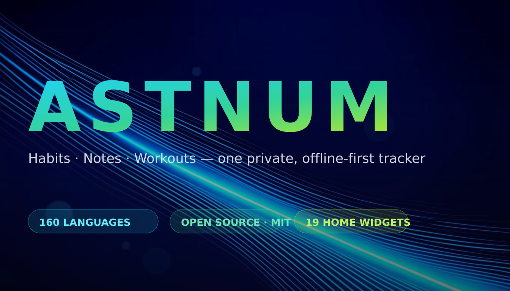
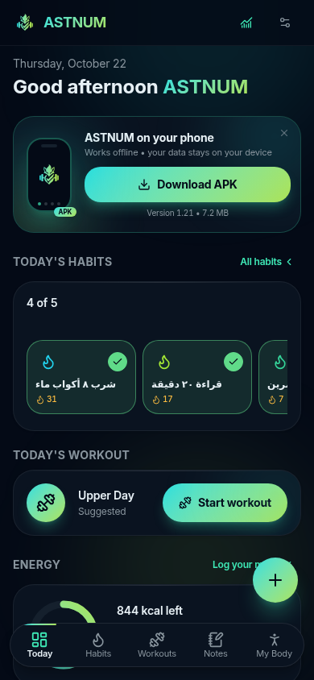
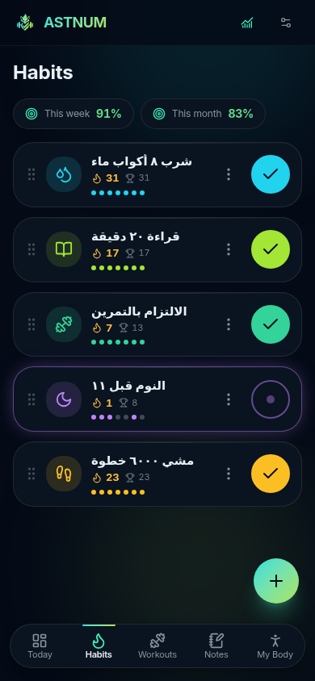
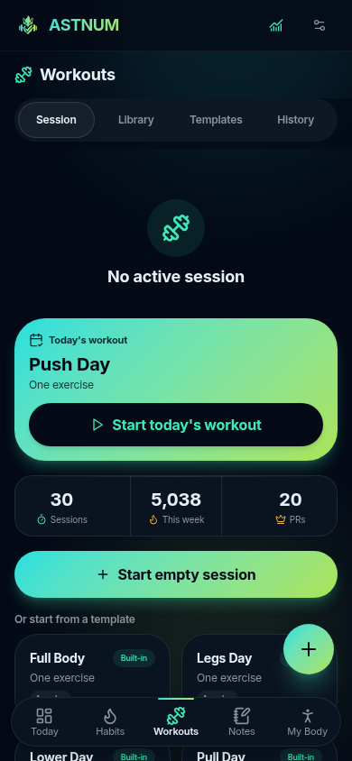
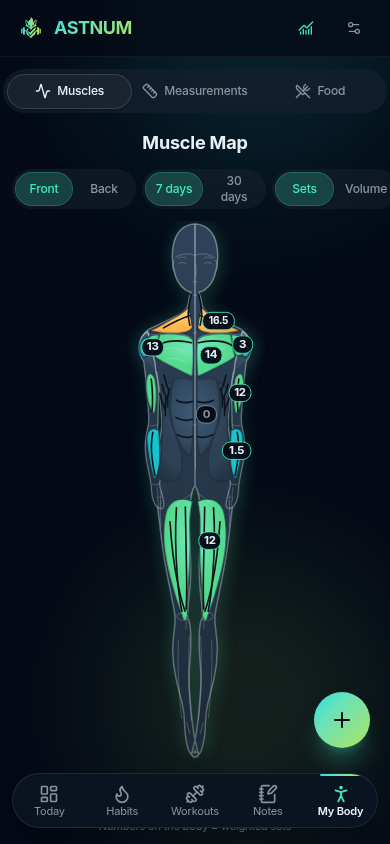
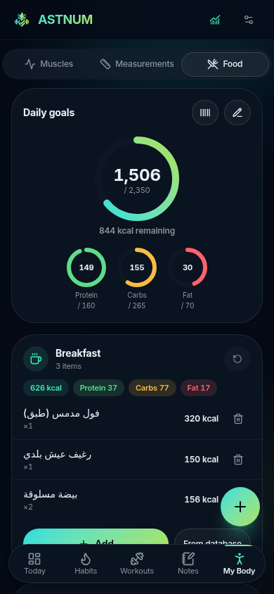
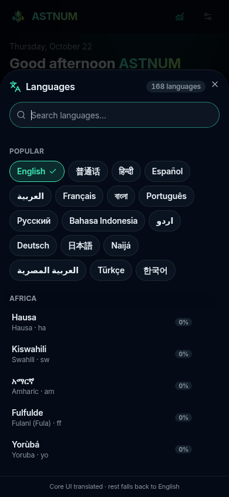

<p align="center">
  
</p>

<h1 align="center">ASTNUM</h1>

<p align="center">
  <strong>Your habits, notes and workouts — in one private, offline-first, open-source app.</strong><br/>
  Available in <strong>160 languages</strong> · 19 Android home-screen widgets · Built with ❤️
</p>

<p align="center">
  <a href="https://github.com/btwstar/astnum/releases"></a>
  <a href="LICENSE"></a>
  
  
  
</p>

<p align="center">
  <a href="README.ar.md">العربية</a> · <b>English</b>
</p>

---

## 📸 Screenshots

<p align="center">
  
  
  
</p>
<p align="center">
  
  
  
</p>

## ✨ What is ASTNUM?

ASTNUM is an **all-in-one self-tracker**: habits, notes & tasks, weight-training
workouts, body measurements, nutrition — plus a statistics screen ("The
Analyst") that computes real numbers from **your own data**.

- 🕸 **No account. No cloud. No tracking.** Everything lives on your device
  (SQLite), and the Android build works fully offline.
- 🌍 **160 languages** — from English, Arabic, Mandarin and Hindi to Hausa,
  Yoruba, Tamazight, Nubian and Chichewa, with full RTL support (Arabic,
  Hebrew, Persian, Urdu, Kurdish, Uyghur, Divehi…). Every widget's own
  titles and labels render in your language too.
- 📱 **19 Android home-screen widgets** — macro rings, meal list, habit/task
  lists, flippable 1×1 tiles, the real muscle heat map, a live workout timer
  you can log sets from *without opening the app*, a full ratios list, a
  **pinned-item widget** (any habit / workout / note you choose, one per
  widget instance), a **real quick-add widget**: type a habit, note *or drink*
  into a dialog floating over your home screen — it is saved to the actual
  database and the widgets refresh, **the app never opens** — plus
  **upcoming events** (your week ahead), a **month calendar** (31 days
  with per-day marks — tap a day to open it inside the app), a **water ring
  (1×1)** and a **drinks quick-add (2×1)** — one tap logs water, juice or
  any drink straight into the hydration tracker.
- 💧 **Hydration tracking with an auto goal** — your daily water target is
  computed from the same body profile as your calories (weight × 35 ml/kg +
  activity), adjustable manually; log water/juice/drinks with one-tap chips
  from the Food screen or the home-screen widgets, with a per-day drink log.
- 🗓 **Calendar editor** — pick the week start (Sun/Mon/Sat) and which day
  marks to render (session / task / habit); the in-app month sheet and the
  month widget follow instantly, with a live preview in Settings.
- 🧠 **Instant statistics** — volume lifted, streaks, consistency, weight
  trends… computed locally, no AI, no network, no judgment.

## 📱 Home-screen widgets (the real add-from-widget)

| Widget | Size | What it shows / does |
| --- | --- | --- |
| Calories / Carbs / Protein / Fat | 1×1 | Canvas progress ring + % — tap opens Today |
| **Water today** | 1×1 | Hydration ring — consumed / auto goal, tap opens Food |
| Today's meals | 4×2 | Four meals, kcal + protein share bars, live totals |
| Today's tasks | 4×2 | Task list — tap a task to complete it |
| Task of the day | 1×1 | One task, flip to the next with a single tap |
| Today's habits | 4×2 | Habits list — one-tap logging, right on the widget |
| Habit of the day | 1×1 | One habit, flip to the next, one-tap toggle |
| Muscle heat | 4×3 | The app's REAL muscle heat map rendered to PNG |
| Workout sessions | 4×2 | Day-assigned plans — tap to start |
| Active session | 4×2 | Live timer + «log set» / «next exercise» without opening the app |
| Today's ratios | 4×3 | 7 computed ratios, two columns |
| **Quick add** | 2×1 | **Type a new habit/note — or pick water/juice/drink + amount — in a dialog over the home screen — saved instantly, app stays closed. Switch habit ⇄ note right inside the dialog** |
| **Drinks** | 2×1 | One tap adds water / juice / another drink to the hydration tracker, with a mini progress bar |
| **Pinned item** | 2×2 | Any one habit / workout / note you choose — permanently displayed, per widget instance |
| **Upcoming events** | 2×2 | The next 4 things ahead this week — scheduled sessions + dated tasks, each opening its home |
| **Month calendar** | 4×3 | The current month like the stock Android calendar — TODAY on a filled circle, up to 3 marks per day (session / task / habit); tap a day to open it in the app |

Widget surfaces are **pure white in light mode / pure black in dark mode**
(following the system theme), with a theme-aware accent set. The quick-add
dialog works in two safe paths: with the app alive the running WebView commits
through the app's own routes; with the process dead a lightweight
same-origin WebView (`public/quickadd/`, built from `src/lib/widgets/`)
commits into the shared localStorage database and rebuilds every widget —
backed by a persistent queue + an idempotency ledger, so a capture can never
be lost or duplicated.

## 🧩 Modules

| Module | Highlights |
| --- | --- |
| **Today** | One glance at your day: habits, workout plan, energy/tasks, muscle heat — live, localized |
| **Habits** | Streaks 🔥, freezes ❄️ (flexible days), custom schedules (daily / N×week / weekdays), icons & colors |
| **Notes & Tasks** | Markdown notes with checklists, tags, pinning, archive & trash — tasks live here too |
| **Workouts** | 160+ seeded exercises, set logging with rest timer, workout templates with day plans, gym-plan scheduling, e1RM history |
| **My Body** | Weight & measurements, trend charts, progress photos with PIN lock, interactive muscle heat map |
| **Nutrition** | Calorie & macro goals per day, four meals (breakfast/lunch/dinner/snack), 170+ food database, quick-add, **hydration tracking with an auto water goal** |
| **Statistics** | Concrete stats about your own data — deterministically computed, works offline |

## 🚀 Quickstart (web)

> **Requirements:** [Bun](https://bun.sh) ≥ 1.2 (or Node 20+), any OS.

```bash
# 1) install dependencies
bun install

# 2) configure the local SQLite path (creates .env from the example)
cp .env.example .env

# 3) create the local SQLite database (db/custom.db)
bun run db:push

# 4) start the dev server
bun run dev
# → http://localhost:3000
```

Seed data (160+ exercises, 170+ foods, 15 muscle groups, 6 workout templates)
loads automatically on first launch.

**Production build** (optional):

```bash
bun run build && bun run start
```

## 🤖 Build the Android APK

The repository ships with the complete **Capacitor** Android project
(`android-app/`) including all 19 native widgets, the quick-add capture
dialog and the white/black app icon.

```bash
# one-shot pipeline (static export → cap sync → gradle assembleDebug)
bash scripts/build-apk.sh
```

Requirements and step-by-step details live in
[docs/capacitor/APK_PIPELINE.md](docs/capacitor/APK_PIPELINE.md) and
[docs/capacitor/ANDROID_BUILD.md](docs/capacitor/ANDROID_BUILD.md).
Debug builds work with the bundled toolchain (see `scripts/toolchain-setup.sh`);
release signing needs your own keystore.

## 🌍 The language system

- **English is the base language** — every UI key exists in it
  (`src/lib/i18n/locales/en/`). Arabic ships complete as the built-in second
  language.
- **160 languages** are registered in `src/lib/i18n/languages.ts` — code,
  native endonym, BCP-47 locale, script direction and fallback chain.
- Translations live in `src/lib/i18n/generated/<code>.ts` and are
  **lazy-loaded** per language (one small chunk per language — the initial
  bundle stays lean).
- Missing keys fall back **own dict → base language (for regional variants
  like es-MX → es) → English**, so a raw key can never reach the user.
- Numbers, dates and plurals use the browser's `Intl` with each language's
  real locale (Arabic-Indic digits for Arabic, Devanagari for Hindi, …).

### Generating / extending translations

All non-core dictionaries are produced by a quality-guarded pipeline:

```bash
bun scripts/i18n/generate.ts          # generate every pending language
bun scripts/i18n/generate.ts --status # progress report
bun scripts/i18n/generate.ts --only de fr
bun scripts/i18n/generate.ts --patch  # complete missing keys of emitted chunks
bash  scripts/i18n/run-all.sh          # self-healing driver: patch + full queue
```

It batches the English source through an LLM with strict validation
(exact key sets, `{{placeholder}}` preservation, plural-variant grammar),
retries, auto-splits oversized batches and caches progress so it can be
interrupted freely. Full tier = the 16 most-used languages (every key);
core tier = the highest-visibility keys for the rest — the language picker
always shows honest coverage.

**Add a new language:** add an entry to
`src/lib/i18n/languages.ts`, run the pipeline with `--only <code>`, and the
picker, RTL, digits and dates all light up automatically.

## 🗂 Project structure

```
├─ android-app/               Capacitor project: native widgets, icons, gradle
│  └─ android/app/src/main/java/app/astnum/mobile/widget/
│                             19 AppWidgetProviders + the quick-add dialog
│                             (QuickAddActivity) + the Capacitor plugin bridge
├─ prisma/schema.prisma       22-table SQLite schema
├─ public/quickadd/           the headless same-origin capture bundle (generated —
│                             rebuild with scripts/build-quickadd-bundle.sh)
├─ src/
│  ├─ app/                    Next.js 16 App Router (single-page shell + API routes)
│  ├─ components/             feature screens (today, habits, gym, notes, body, nutrition…)
│  ├─ lib/
│  │  ├─ i18n/                languages.ts registry · dictionaries · generated/ chunks
│  │  ├─ widgets/             snapshot builder · capture processor · bridge · headless entry
│  │  ├─ logic/               pure engines: streaks, PRs/e1RM, calories, analyst stats
│  │  └─ store/               zustand app store (theme, units, language, tabs)
│  └─ …                       ui (shadcn), seed data, theme, offline api adapter
├─ scripts/
│  ├─ i18n/                   generate.ts (pipeline) · run-all.sh (self-healing driver)
│  ├─ build-apk.sh            web export → cap sync → gradle build
│  ├─ build-quickadd-bundle.sh bundles the headless quick-add page
│  └─ brand/make-banner.ts    regenerates the brand banner
├─ docs/                      full documentation — index in docs/README.md
│   ├─ capacitor/             Android build & signing, APK pipeline
│   ├─ screenshots/           app screenshots referenced by the READMEs
│   └─ play/                  Play Store listing text + graphic sources
└─ assets/brand/              banner, icon sources
```

## 🧰 Tech stack

**Next.js 16 (App Router)** · **TypeScript 5** · **Tailwind CSS 4 + shadcn/ui**
(New York) · **Prisma + SQLite** · **Zustand** (+ TanStack Query) ·
**Capacitor 7** → Android WebView · **Recharts** · **date-fns** ·
**Framer Motion** · **lucide-react**.

Design: dark-first neon identity (cyan→mint→lime gradient), OKLCH custom
accent colors, full RTL layouts with logical properties, haptic feedback.

## 📜 Scripts

| Command | Description |
| --- | --- |
| `bun run dev` | Dev server on port 3000 |
| `bun run build` / `start` | Production build / serve |
| `bun run lint` | ESLint (Next.js config) |
| `bun test` | Unit tests — 103 tests over the pure logic engines |
| `bun run db:push` | Create/Update `db/custom.db` from the Prisma schema |
| `bun scripts/i18n/generate.ts` | Translate/extend the generated dictionaries |
| `bash scripts/i18n/run-all.sh` | Self-healing i18n driver (patch + every pending language) |
| `bash scripts/build-apk.sh` | Full Android APK pipeline |
| `bash scripts/javac-gate.sh` | Fast native-widget compile check (aapt2 + javac, no gradle) |

## 🤝 Contributing

Issues, feature ideas and pull requests are **very welcome** — see
[CONTRIBUTING.md](CONTRIBUTING.md). Translations are the easiest way to help:
the pipeline (`bun scripts/i18n/generate.ts --only <code>`) does the heavy
lifting, and native-speaker review PRs are pure gold.

## 📄 License

Released under the **MIT License** — see [LICENSE](LICENSE).
© 2026 [btwstar](https://github.com/btwstar) and ASTNUM contributors.

## 🙏 Acknowledgements

- Seed exercise/food/muscle content assembled for offline-first use.
- Built on outstanding open-source work: Next.js, Prisma, Tailwind, shadcn/ui,
  Capacitor, Recharts, Rehype/MDX and more.
- The widget system was designed for stock Android launchers (works with
  Nova, Pixel Launcher, One UI home…).
